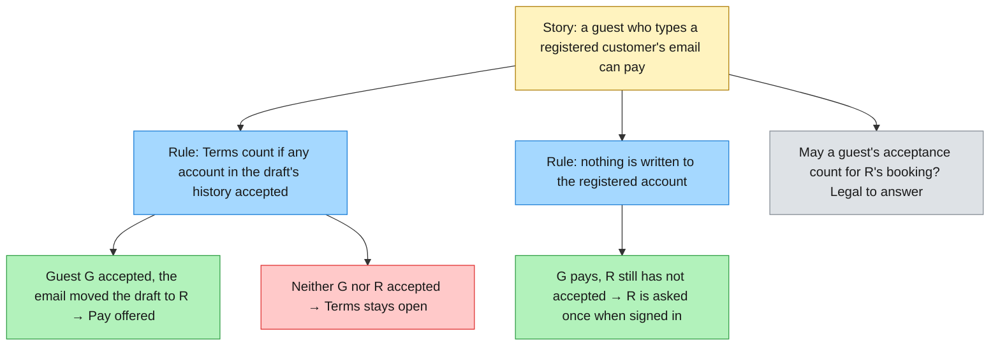
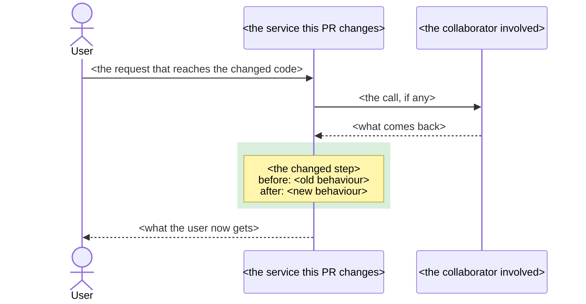

# Writing Pull Requests

A pull request is a **request for someone else's time** and a **permanent entry in the project's history**. Optimize for the reviewer and for the engineer who reads `git log` in two years — not for the writer. The central test: **can a reviewer learn what changed, why, and where the risk is, without opening the diff or the ticket — and review it in one sitting?**

## Core Philosophy

- **The reviewer is the customer.** Their time and attention are the scarce resource. Every choice — size, title, description, read-order — should reduce their cognitive load.
- **Small, focused, single-concern.** The strongest predictor of a fast, effective review is a small, single-purpose diff. Almost every other problem (slow reviews, missed defects, scope arguments) traces back to a PR that did too much.
- **The description is the contract and the story.** It states intent and the edges crossed; the diff shows the mechanism. A reviewer should be able to validate the diff *against* the description.
- **Self-review first.** Read your own diff hunk-by-hunk as if it were someone else's before you request review. Most "review comments" are things you'd have caught yourself.
- **Ship when it improves code health.** Perfect is the enemy of merged. Approve (and request merge of) a change that definitely improves the codebase, even if it isn't ideal — file follow-ups for the rest.

---

## 1. One Concern Per PR (the splitting rule)

**If you can't describe the PR without the word "and", it is two PRs.** A feature *and* a refactor, a fix *and* a config change, two unrelated bug fixes — split them.

- **Land refactors separately, first.** A cross-cutting rename, an interface reshape, or a client split should be its own PR that merges *before* the feature that needs it. This shrinks the feature diff to only the lines that are actually about the feature, and lets a risky refactor be reviewed (and reverted) on its own.
- **Stack, don't bundle.** When changes genuinely depend on each other, stack them as a chain of small PRs (or sequential commits with clean seams) rather than one mega-PR. A commit-per-step discipline (e.g. test → impl → refactor) already gives you the seams to extract.
- **Why it matters:** a single-concern PR can be reviewed quickly, reverted cleanly during an incident, and understood in isolation later. A braided PR gets rubber-stamped, not reviewed.

---

## 2. Size — keep it to one sitting

The empirical backbone (SmartBear/Cisco study of ~2,500 reviews over 3.2M LOC): **defect detection peaks at 200–400 changed LOC reviewed in a 60–90 minute session and drops sharply beyond ~400 LOC / ~90 minutes.** Google calls ~100 lines a "reasonable" CL and 1,000 lines "usually too large." Merge-velocity data points even smaller (~50 lines ideal; elite teams average a few hundred per PR).

**Practical tiers (production lines):**

| Size | Verdict |
|---|---|
| < 100 LOC | ideal |
| 100–300 | good |
| 300–500 | acceptable **with** a strong description + a "where to look" roadmap |
| > 500 LOC or > ~10 files | split it |

- **File-spread counts as much as raw lines.** 200 lines across 50 files is too large; 200 in one file is fine. Aim for ≤ ~10 files.
- **Judge production code separately from tests.** A PR that's +1,600/-90 but is 1,000 lines of tests still has ~500 production lines that need full-attention review — count those.
- **Hit the budget by scoping, not by counting after the fact.** Pick one concern; stack refactors out. The line count is a *symptom* of scope, not a target to game.
- *Caveat on the numbers:* the per-bucket detection-rate tables circulating in blogs are extrapolations, and vendor telemetry (e.g. "50 lines / 40% faster") is directionally sound, not gospel. The 200–400 band and "small is better" are the robust findings.

---

## 3. The title — a Conventional-Commit line that names the problem

- One imperative line, **Conventional-Commit** form: `type(scope): summary` (e.g. `feat(draft-shipments): copy a draft onto its matching itinerary`). It must stand alone in `git log`.
- **Name the problem, not the fix** — and never the mechanism (`Moving code from A to B`, `Phase 1`, `Fix stuff` all fail).
- **Mark breaking changes with `!`** before the colon (`feat(api)!: …`).
- Don't paste the 40-commit log as the title or body.

---

## 4. The description — make it stand alone

A reviewer (and a future archaeologist) should learn **what changed, why now, and the design decision worth a second look** without opening the diff or the ticket. Write **prose**, not a commit dump.

Structure around **What/Why · Changes · Testing · Risk & rollback**, plus the edges below. Explain the **root cause** (for a fix) and the **decision + the alternative not taken** (for a feature) — not the obvious.

### Enumerate every contract edge the change crosses

A reviewer reads a PR as *edges crossed*, not lines added. List, explicitly (or "none"):

- **Inbound API** — new/changed routes (prefer additive + versioned). Declare the full response contract (every status code).
- **Outbound calls** — new calls to other services; confirm the client has **auth + resilience** wired, and that **transport failures map to typed outcomes** (e.g. 404 / 422 / 502), never a raw exception to a bare 500.
- **Idempotency / retry** — for any **mutating** outbound call under an auto-retrying resilience policy: either confirm the upstream dedupes (with a test pinning "dropped-response-then-success → one side effect") or disable retries for that call. A retried POST can double-apply.
- **Config** — every new/`required` key, with its **per-environment** value, and confirmation that **out-of-repo** sources (Helm/values, secret store, pipeline-injected settings) are updated too. A `required` key missing in one environment is a guaranteed crash-on-boot there. State deploy ordering.
- **Events / schemas** — never mutate or remove a field on an existing event (it's immutable history); add a new versioned event. 
- **Database migrations** — see §5.

### Show the change in small diagrams of what changed

Before the prose, give the reviewer the shape of the change: **a diagram scoped to what this PR changes, with the changed part highlighted.** GitHub renders Mermaid natively in PR descriptions and comments (a fenced block tagged `mermaid`), so it costs the reviewer nothing to open.

Pick the diagram by what the change is about:

| The change is about… | Diagram | Recipe |
|---|---|---|
| **A policy or business rule**: who may, when, what wins, what doesn't apply | **Example Mapping**: story, rules, examples that apply and don't, open questions | below |
| **A process** across steps, actors or services: what happens in order, who decides, what reacts | **Event Storming** (process level) on one straight line | below |
| How components or services talk (calls, events, async steps) | Mermaid **sequence** diagram | template in §7 |
| The logic of one path (a guard, a branch) | **sequence** with a highlighted note, or a small **flowchart** | template in §7 |
| Part of an existing call flow | a `diff`-coloured call tree (the `pr-flow` skill traces it from the entry point) | — |
| Layout or a broad refactor | a shallow file tree, or a `diff` of it | — |
| A new shape a reader must copy | the code block itself | — |

**One or more.** Use one diagram when one view carries the change, and more when the change has more than one face. Example: a fix that changes a rule *inside* a process gets an Event Storming line for where it happens and an Example Map for what the rule now says. Give each diagram a one-line caption naming the question it answers ("Where in the booking does this happen?", "What does the rule now say?"). Stop at three; past that, the PR is probably doing too much (§1).

Make each a picture of **the change**, not of the system:

- **Highlight the changed step.** In a sequence diagram, wrap it in `rect rgba(46, 160, 67, 0.18) … end`; the translucent green reads in both light and dark mode. Put **before/after** inside one note on that step: `Note over X: before: …<br/>after: …`.
- **Say so in one line above it:** "The highlighted step is the only behaviour this PR changes."
- **Keep it small:** 3–4 participants and about 10 messages. Use the prod case or ticket example's own names (guest G, registered R) so it matches the root-cause paragraph.
- **List what does *not* happen under the diagram** (the guard arms) in one sentence rather than drawing every branch.

Mermaid on GitHub has sharp edges:

- **`;` ends a statement**, even inside a note or message label. Write "so" or "," instead.
- GitHub **pins its Mermaid version**, so newer syntax may not render. A `mermaid` block containing only `info` shows the version.
- **Render it before publishing:** paste it into the Mermaid live editor, or a local page that loads Mermaid from a CDN. A diagram that fails to parse shows reviewers a syntax error instead of your change.
- **Regenerate it on every push that changes behaviour.** A stale diagram is a confident wrong claim about the diff.

#### Recipe: Example Mapping for a policy or rule

Yellow story, blue rules, green examples where the rule applies, pink where it does not, grey open questions (Matt Wynne's colours). Take the examples from the team's Example Mapping board when one exists, verbatim, and name the tests after them, so the PR, the board and the test names say the same thing.



Only the rules this PR adds or changes, with two or three examples each. An open question that blocks merge goes in grey here *and* as *Not confirmed* in the confidence card.

#### Recipe: Event Storming for a process

A process-level storm on **one straight line**, never a grid: command → system or aggregate → event → policy → next command. Orange events (past tense), blue commands, lilac policies ("whenever X → Y"), yellow aggregate or process, pink external systems, small pale-yellow actors joined by a dotted line. **Outline the changed sticky** in green rather than drawing a second line.

```mermaid
flowchart LR
    C1["save the billing contact"]:::command --> S1["Olive"]:::system --> E1["Draft's account set to registered R"]:::event --> P1["whenever a draft is saved → work out its actions"]:::policy --> A1["Draft Shipment Progress"]:::aggregate --> E2["Terms done: an account in the history accepted"]:::event --> E3["Pay offered"]:::event
    U1(["Guest"]):::actor -.-> C1
    style E2 stroke:#2da44e,stroke-width:4px
    classDef event fill:#ffc078,stroke:#e8590c,color:#1a1a1a
    classDef command fill:#a5d8ff,stroke:#1c7ed6,color:#1a1a1a
    classDef policy fill:#d0bfff,stroke:#7048e8,color:#1a1a1a
    classDef aggregate fill:#ffec99,stroke:#f08c00,color:#1a1a1a
    classDef system fill:#fcc2d7,stroke:#d6336c,color:#1a1a1a
    classDef actor fill:#fff9db,stroke:#f08c00,color:#1a1a1a
```



Show the stretch of the process around the change, about 6–8 stickies, not the whole storm. Link the full board (Miro, FigJam) under the diagram. Hot spots stay on the board; in the PR they become *Not confirmed* assumptions or Deferred items.

Both recipes set their own fill **and** text colours, so they read in light and dark mode. Quote every label (`["…"]`) so brackets, colons and arrows inside the text don't break the parser.

The evidence that diagrams speed up review is thin: small, pre-LLM studies of perceived benefit (ReviewVis, Striffs). Use a diagram because it makes the change cheaper to understand at a glance, and keep it honest and small. A picture that needs its own explanation is the wrong picture.

### AI-assisted PRs: disclose, sign off, show the reasoning

When an agent wrote the code, the tests or the description, say so and show how it reasoned. In a matched study of Claude Code PRs, agent PRs were merged less often than the same authors' human PRs (83.8% vs 91.0%, Watanabe et al., TOSEM). Reviewers lacked the reasoning, not the result. LLVM's AI policy sets the norms that close that gap:

- **Disclose it at the top**, and in commits (`Assisted-by:` or `Co-Authored-By:` trailer). Labelling is there to make review easier, not to apologise.
- **A human reads every line before requesting review** and can answer for it. The contributor is the author and is accountable. Put an unticked box in the PR for the author to tick; never tick it on their behalf.
- **Add a confidence card**:
  - **Plan**: the steps taken, such as the failing test first, then the fix, then the review.
  - **Assumptions**: each marked *Checked* (with the evidence) or *Not confirmed* (with who must answer, in bold if it blocks merge).
  - **Alternatives considered**: one clause each on why not.
  - **Edge cases**: what happens at each boundary, including what deliberately does *not* happen.

The confidence card replaces a loose "decision worth a second look" paragraph. Unconfirmed assumptions are exactly what the reviewer should challenge.

### Merge danger: which door, and how wide the blast

Say whether the change is a **one-way or a two-way door** (Bezos). A two-way door is cheap to walk back: revert and redeploy. A one-way door is not: a destructive migration, a published event or contract other teams consume, deleted data, a decision others will build on. Then name the **blast radius**: who or what feels it if it goes wrong (one endpoint, every consumer of a message, the mobile layout, a nightly job). Reviewers spend their attention where the door is one-way and the radius is wide.

### Breaking changes — impossible to miss

A bold **`BREAKING CHANGE:`** block at the top: what breaks, who is affected, and the required consumer action. A breaking config-key rename, a removed/renamed field, a changed response shape, a changed status code — all qualify.

---

## 5. Safety & CI gates the PR must clear

- **The full CI suite is the merge gate**, not the fast local loop. Cross-service contracts only break in the integration/container suites; a green unit run is necessary, not sufficient. Link the green run. Build is warning-clean.
- **No secrets** in the diff (URLs are fine; credentials/connection strings go to the secret store).
- **Migrations follow expand/contract** (zero-downtime): additive nullable/defaulted columns + new tables in an **expand** step; never rename/drop an in-use column in the same deploy that reads the new shape; **contract** (drop old structures) in a later deploy. Each migration has a tested reverse (`Down`), a lock/duration estimate for large tables, and must **not** ship in the same PR as the code that depends on the new shape.
- **Feature-flag** risky or incomplete behaviour so it can be shipped dark and toggled without a redeploy.
- **Observability before merge** — the new unit of work emits one canonical wide event (inputs + decision + outcome + downstream durations) and a span tagged with the slice keys (ids, outcome) you'd group by in an incident; high-cardinality ids go on the span/event, never on metric labels. The description answers: *"how will we know this broke in prod, and why, without shipping new code?"*

---

## 6. Author self-review checklist (before requesting review)

- [ ] I walked the diff **hunk-by-hunk** — no debug artifacts, no commented-out code, no `TODO`s I meant to remove.
- [ ] **One concern**; refactors split out or stacked.
- [ ] No **stray working-tree files** rode along (local-only tooling manifests like a pinned-SDK file, scratch/WIP docs, editor configs).
- [ ] No **secrets** in the diff.
- [ ] Every new/`required` **config key** is present in **all** environments + the out-of-repo sources.
- [ ] Every new **outbound client** has auth + resilience; retry-safety stated for mutating calls.
- [ ] Every new **outcome/branch has a test that fails if it regresses** — happy path **and** each failure arm; tests assert ordering (no downstream side effect on the error/no-match paths), not just return values.
- [ ] Any **intentionally lossy / best-effort** behaviour is flagged as an owned policy with a one-line rationale (mirrored in a test comment) — so it can't be mistaken for a bug.
- [ ] The change is **observable**; the description says how we'll know it broke.
- [ ] **Full CI suite is green**; build warning-clean.
- [ ] Title + description **stand alone**; ticket linked; "where to look" pointer for any non-trivial diff.
- [ ] Each **diagram shows only what changed** (Example Map for a rule, Event Storming line for a process, sequence for an interaction), the changed part is highlighted, each has a one-line caption, and each **renders** (no `;` inside labels, quoted node labels) and matches HEAD.
- [ ] If an agent helped: **disclosed** at the top and in commit trailers; a **human has read every line** (the author ticks the box); the **confidence card** marks each assumption *Checked* or *Not confirmed*.

---

## 7. The PR description template

````markdown
> **AI-assisted.** <!-- delete if no agent helped --> Written with <tool/model>: <code, tests, this description>. Commits carry a `Co-Authored-By` trailer.
> - [ ] The author has read the full diff and can answer for every line *(tick before requesting review)*

## What & Why
<!-- One imperative sentence: what changes for the caller/user and why now. Matches the PR title. -->

Closes: <!-- TICKET-NNN / #NNN --> · Stack: <!-- "1 of 3 → #NNN", if stacked -->

## What changes
<!-- One diagram per question this change raises, at most three (§4):
     a policy → Example Map · a process → Event Storming line · an interaction → sequence (below).
     Caption each with the question it answers. -->

The highlighted step is the only behaviour this PR changes.



<!-- One sentence on what deliberately does NOT happen (the guard arms). -->

**Root cause** (fix) / **why now** (feature): <!-- the concrete case: ids, timestamps, the evidence link -->

**Contracts crossed** (or "none"):
- Inbound route(s): <!-- e.g. POST v1/resource/{id}/action (additive, versioned) -->
- Outbound call(s): <!-- service + endpoint; auth + resilience wired? retry-safe if mutating? -->
- Config keys added/renamed: <!-- key → per-env value; out-of-repo sources updated? -->
- Events / schema / migrations: <!-- new versioned event? expand/contract migration? or "none" -->

## Confidence card
- **Plan.** <!-- the steps taken: failing test → fix → refactor → review → fixes -->
- **Assumptions**
  - <!-- assumption --> *Checked:* <!-- evidence -->
  - <!-- assumption --> *Not confirmed:* <!-- **who must answer before merge** -->
- **Alternatives considered:** <!-- option (why not); option (why not) -->
- **Edge cases**
  - <!-- boundary → what happens, including what deliberately doesn't -->

## Testing
- [ ] Full CI suite green (incl. integration/container tests) — link: <!-- run -->
- [ ] New tests cover every new outcome/branch (happy path AND each failure arm)
- [ ] Contract test pins the real upstream wire shape (if a new boundary)
- [ ] Manual / staging validation: <!-- what, where, which edge cases -->

Edge cases & intentional best-effort behaviour:
<!-- empty/null, duplicates, ordering, ties, partial records, stale upstream data;
     name any deliberately lossy choice + one-line rationale -->

## Observability
<!-- Wide event name + key fields; span tags / outcome bucket a responder would group by.
     How will we know this broke in prod without shipping new code? -->

## Risk & rollback
- Door: <!-- one-way / two-way, and why -->
- Blast radius: <!-- who or what feels it if this goes wrong -->
- Deploy profile: <!-- e.g. "stateless — no migration/event-schema change" -->
- Rollback: <!-- "revert this PR / redeploy prior image"; note if a config rename must be reverted per-env too -->
- Breaking change? <!-- if yes: bold BREAKING CHANGE + consumer action; else "none" -->

## Screenshots
<!-- Before | After for any UI/CLI/visible-output change; delete if N/A -->

## Review focus
<!-- "Start here: <file>." Name the 3–4 load-bearing files + a suggested read order. -->

## Deferred / fast-follow
<!-- What was deliberately left out, why it's safe to ship without it, linked ticket. -->
````

Keep it lean — delete sections that are genuinely N/A rather than filling them with noise. A repo-level `.github/pull_request_template.md` makes this the default for every PR.

---

## 8. Anti-patterns (what makes a PR painful)

- **The "and" PR** — a feature + a cross-cutting refactor + config changes braided together. Unreviewable, un-revertable in an incident.
- **The 40-file / 1,000-line review request** — past the defect-detection cliff; gets rubber-stamped. The single biggest controllable driver of missed defects and review latency.
- **Vague or commit-dump title/description** — `Fix copy`, `Phase 1`, the 40 commit subjects concatenated. No standalone context.
- **A breaking `required` config rename buried as a silent line** with no env enumeration → clean review, boot-loop in the environment whose value was missed.
- **A non-idempotent POST left under auto-retry** with no word on double-apply safety → silent duplicate side effects, invisible in happy-path tests.
- **An upstream failure escaping as a bare 500** instead of a typed outcome → callers can't tell "retry me" (502) from "your input is wrong" (422).
- **A new branch/outcome with no test** — especially an untested failure arm.
- **Undocumented best-effort behaviour** — a silently dropped selection, a silent tie-break — indistinguishable from a bug to the reviewer and to on-call six months later.
- **A new endpoint/consumer with no wide event/span**, or high-cardinality ids shoved onto **metric labels**.
- **Mutating an existing event's schema**, or a migration that drops an in-use column / lacks a reverse / ships with the code that depends on it.
- **Drive-by working-tree files** — a local-only SDK pin, scratch docs — that break CI or every teammate's build.
- **"It passed locally" as the merge gate** for behaviour behind a mocked external boundary. Any red/skipped test, or a build with suppressed warnings.
- **A stale narrative** — a PR story (or committed WIP doc) describing behaviour the HEAD no longer has.
- **A diagram of the whole system** instead of the change, or one with every branch drawn — the reviewer has to find the change in it. Highlight one step; list the guard arms in a sentence.
- **The wrong picture for the change** — a sequence diagram for a policy change (the rule hides in a note) or for a multi-step process (no actors, no policies). Use an Example Map for a rule, an Event Storming line for a process.
- **A diagram zoo** — four or more pictures, or two that answer the same question. One diagram per question; past three, split the PR.
- **A diagram that doesn't render or no longer matches HEAD** — a syntax error box, or a flow the last push changed. Render it before publishing; regenerate it on push.
- **An unlabelled agent PR, or one nobody human has read** — reviewers can't calibrate their trust, and the author can't answer for the lines. Disclose, sign off, add the confidence card.
- **Comments added to production code** to explain non-obvious logic instead of making the code self-documenting and putting the *why* in the PR description or a test.
- **Reviewer perfectionism** — blocking a net-improvement over imagined-future concerns, or letting a PR stall on unanswered nits instead of approving-with-nits or escalating.

---

## 9. Handling review comments

- **Frame your own review comments as questions** ("what happens if this is empty?") and label nits as nits.
- **Respond to every comment** — acknowledge even when you disagree. Silence stalls the PR.
- **Fix the misunderstanding in the code, not just the thread** — if a reviewer misread it, a rename or an added test usually beats a reply.
- **Escalate a stalled text debate to a synchronous chat**, then post the decision back to the thread so it's on the record.
- **After pushing fixes, use "re-request review"** rather than a bare comment, so reviewers/code-owners are notified. Keep the PR in **Draft** while CI is red or the approach is moving; flip to **Ready** only when it genuinely is.
- **Reviewers: approve when the change improves code health** — don't hold a net-improvement hostage to perfection.

---

## Reading

- **Google Engineering Practices** — *Small CLs*, *Writing good CL descriptions*, *The Standard of Code Review*, *What to look for in a code review*, *Speed of Code Reviews*, *How to handle reviewer comments* (google.github.io/eng-practices).
- **GitHub** — "How to write the perfect pull request" (Keavy McMinn); "How to review code effectively" (Sarah Vessels); GitHub flow; PR templates; draft PRs (github.blog / docs.github.com).
- **SmartBear / Cisco** — *Best Practices for Peer Code Review* and the Cisco case study (defect detection vs review size/speed).
- **Conventional Commits 1.0.0** — conventionalcommits.org.
- **Empirical** — Bacchelli & Bird, *Modern Code Review* (MSR); Zhang et al., *Pull Request Latency* (ESE 2022); "Do small code changes merge faster?" (arXiv 2203.05045); LinearB engineering benchmarks.
- **AI-assisted PRs** — Watanabe et al., *On the Use of Agentic Coding: An Empirical Study of Pull Requests on GitHub* (ACM TOSEM; arXiv 2509.14745), the merge-rate gap and the confidence-card proposal; *LLVM AI Tool Use Policy* (llvm.org, `AIToolPolicy`), disclosure, human-in-the-loop and accountability.
- **Example Mapping** — Matt Wynne, *Introducing Example Mapping* (Cucumber blog, 2015). **Event Storming** — Alberto Brandolini, *Introducing EventStorming* (process-modelling level).
- **Diagrams in review** — GitHub Docs, *Creating diagrams* (Mermaid in Markdown, pinned version); Fregnan et al., *ReviewVis* (JSS 2023) and Fadhel & Sekerinski, *Striffs* (ICCQ 2021), perceived benefit and keeping structure diffs small; CodeRabbit walkthrough and Bito interaction-diagram docs, sequence diagrams only when interactions change, updated on each push.
- **Delivery & safety** — expand/contract migrations (Prisma DataGuide); rollback strategies (Octopus); feature-flag practices (Octopus); pipeline quality gates (InfoQ); breaking-change discipline (InfoQ, semver); observability-driven development (Charity Majors).
